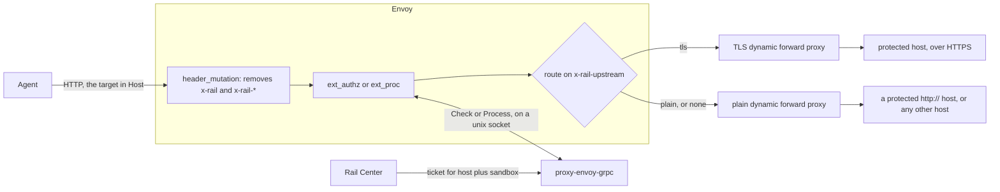
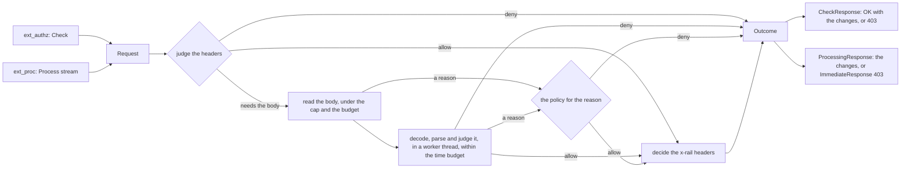

# proxy-envoy-grpc

`proxy.envoy_grpc`, an Envoy gRPC extension service. Envoy calls it on each
request, over ext_authz or ext_proc. It adds the `x-rail` headers to requests
for protected hosts, and judges every request, refusing one its rules refuse.
See the [main README](../README.md) for the whole.

## Architecture



The agent's HTTP traffic goes through Envoy, and Envoy calls this service
(ext_authz or ext_proc, on a unix socket) for every request before forwarding
it. Envoy
forwards the agent's own request, rather than building a new one as
[proxy-standalone](../proxy-standalone/README.md#architecture) does. The
service answers with the headers to set and remove; for a protected host that
includes `x-rail-upstream`, which picks the route, and `:authority`, which says
where to connect.

Before the call, Envoy removes any `x-rail` or `x-rail-*` header the agent
sent. The service then looks at the request's host:

- **Not protected:** it changes nothing, and Envoy forwards the request as the
  agent sent it.
- **Protected:** it sets `x-rail` with the ticket, or `x-rail-status` with the
  reason there is none (`not-found`, `expired` or `issuer-unreachable`), or
  neither when the plugin is off. It also tells Envoy how to reach the host:
  over HTTPS unless its entry says `http://`, at the entry's port if it names
  one, else the agent's.

The agent's other headers are forwarded as sent, to protected hosts too,
`Authorization` included, except any with `_` in its name: Envoy drops those,
since many servers read `_` as `-`, and `x_rail` would reach one as `x-rail`.

The service also judges each request, and refuses one its rules refuse:
[Judging requests](#judging-requests). Until rules exist, it allows every
request. Inside the service, both callouts run the same steps:



A failure before the verdict follows `RAIL_PROXY_ON_JUDGE_FAILURE`; one in
`decide` forwards the request unchanged
([Timeouts and failures](#timeouts-and-failures)).

### Principles

1. **Envoy fails open.** If the service can't be reached, Envoy still
   forwards the request.
2. **The service fails open.** No ticket yet, Rail Center down, or an error
   inside the service while deciding the `x-rail` headers: the request is
   still forwarded. Judging is the exception: a request the rules refuse, or
   one that can't be judged, is refused.
3. **Only the service adds `x-rail-status`.** Envoy removes the agent's, and
   never adds one of its own.
4. **HTTPS only for protected hosts, unless their entry says `http://`.** An
   unprotected request is never upgraded.
5. **The agent's port, unless the entry names one.**

### When the service is down

Envoy forwards every request as if its host weren't protected:

- no `x-rail` and no `x-rail-status`, so a gateway sees no identity and no
  reason, as from an agent with no proxy at all;
- no routing: a protected host is reached over plain HTTP at the host and port
  the agent sent, so the request usually fails to connect;
- the ticket is never sent, since only the service attaches it.

Envoy doesn't report this in its log: the access log line for a request
forwarded this way carries no flag. Only Envoy's statistics count it
(ext_authz's `ext_authz.failure_mode_allowed`), and the e2e stack's config exposes none, so
watch the service's own health probe instead.

### At startup

The socket is bound at once, without waiting for the first ticket. Until it
arrives, protected requests get `x-rail-status: issuer-unreachable`.

## Judging requests

The service judges every request against rules, and refuses one they refuse
with `403` and the text `request refused by policy`. The rules, and fetching
them from Rail Center, are still to come: until then every request is allowed.

A rule can read the request's method, URL and headers, and its body, but
never an `x-rail` header. The headers are judged first, and the body is read
only when a rule that still applies needs it, so a deployment whose rules
never need a body never has one read. A header the agent repeated reaches a
rule as one comma-joined value over ext_authz, unless it sets
`encode_raw_headers`, and as each value over ext_proc.

### Which callout

The service answers both on the same socket; Envoy's config picks one.

| Envoy's config | The service gets |
|---|---|
| ext_authz, as [`envoy.yaml`](../e2e/envoy-grpc/envoy.yaml) | the headers |
| ext_authz with `with_request_body` | the headers and the body in one message: whole, or its start with `allow_partial_message` |
| ext_proc with `request_body_mode: NONE`, as [`envoy-ext-proc.yaml`](../e2e/envoy-grpc/envoy-ext-proc.yaml) | the headers |
| ext_proc with a body mode | the headers, then the body in that mode |

Configure one callout. Both work in one chain, but each request is then judged
twice.

**ext_authz with a body** needs `pack_as_bytes: true`. Without it, Envoy
replaces every byte that isn't UTF-8 with `!`, so the service judges the body
as not sent, and warns once. Without `allow_partial_message`, Envoy answers
`413` itself to a body over `max_request_bytes`. Keep `max_request_bytes` at
or under `RAIL_PROXY_MAX_BODY_BYTES`: a larger body comes in a message the
service refuses unread, which Envoy takes as a failed callout. A body rule
needs `with_request_body` even for chunked uploads: without it, Envoy doesn't
tell the service a chunked body exists.

**ext_proc's body modes.** The service never changes the mode Envoy is
configured with; it reads it from Envoy's first message. When a rule needs
the body, in every mode the service holds the body's parts until its verdict,
and Envoy sends nothing upstream, headers included, before then.

| `request_body_mode` | |
|---|---|
| `NONE` | no body: a body rule judges it as not sent |
| `BUFFERED` | Envoy buffers the whole body first. Raise the listener's `per_connection_buffer_limit_bytes`: past it (1 MiB by default) Envoy answers `413` itself. Keep it at or under `RAIL_PROXY_MAX_BODY_BYTES`, as `max_request_bytes` above |
| `BUFFERED_PARTIAL` | as `BUFFERED`, but a body over Envoy's buffer arrives truncated |
| `STREAMED` | with `send_body_without_waiting_for_header_response`, the answer to the headers waits for the body too |
| `FULL_DUPLEX_STREAMED` | needs `request_trailer_mode: SEND`; the service sends the body back to Envoy |

**A body that trailers follow** has no part that ends the stream, and Envoy
sends the trailers only once the body is answered, whatever
`request_trailer_mode` says:

- `BUFFERED`: the one part is the whole body, and is judged.
- `BUFFERED_PARTIAL`: it looks like a body cut short, and is `truncated`.
- `STREAMED`: nothing says the body ended, so it can't be judged. The request
  waits until `message_timeout`, and is then answered by `failure_mode_allow`.
- `FULL_DUPLEX_STREAMED`: the trailers come without waiting, end the body,
  and it is judged.

An agent sends trailers over HTTP/2, or over HTTP/1 when the listener sets
`enable_trailers`. Where it might, body rules need `BUFFERED` or
`FULL_DUPLEX_STREAMED`.

While the service holds a part, Envoy waits for its answer under ext_proc's
`message_timeout`, 200 ms by default, so a slow upload in a streamed mode
runs into it. A deployment with body rules raises it to cover the slowest
upload it accepts.

### Bodies that can't be judged

A body the service can't judge as it is gets a reason, and is refused unless
`RAIL_PROXY_ALLOW_UNREADABLE_BODY` lets that reason through unjudged:

| Reason | When |
|---|---|
| `not-sent` | Envoy's config sends no body, or ext_authz sends it without `pack_as_bytes` |
| `truncated` | ext_authz's `allow_partial_message`, or ext_proc's `BUFFERED_PARTIAL`, cut it short |
| `too-large` | past `RAIL_PROXY_MAX_BODY_BYTES` (8 MiB) |
| `over-budget` | the bodies held at once would pass `RAIL_PROXY_BODY_BUDGET_BYTES` (32 MiB) |
| `unsupported-encoding` | a `Content-Encoding` other than `gzip` or `identity` |
| `decoded-too-large` | decoded past `RAIL_PROXY_MAX_BODY_BYTES`: a decompression bomb stops there |
| `malformed` | gzip, or a JSON body, that doesn't decode |
| `timed-out` | not judged within `RAIL_PROXY_BODY_TIMEOUT_SECONDS` |

A refusal is logged with its reason, or, when the rules refuse, with the
request's host and the stage they refused it at; never with a header value or
any of the body.

### Timeouts and failures

A body is decoded, parsed and judged in a worker thread, so a large one
stalls no other call, within `RAIL_PROXY_BODY_TIMEOUT_SECONDS` (0.15 s),
under Envoy's default callout timeouts of 200 ms (ext_authz's `timeout`,
ext_proc's `message_timeout`). Keep it under yours.

A body still being judged when that time runs out is refused as
`timed-out`. Its thread can't be stopped, so it keeps its share of
`RAIL_PROXY_BODY_BUDGET_BYTES` until it ends, and stops at its next step.

A callout that fails or times out is Envoy's to answer, by
`failure_mode_allow`: forwarded unjudged when true, answered with an error
when false (on a timeout, ext_authz's `403` and ext_proc's `504`). The service
never sees it. So body rules hold only with `failure_mode_allow: false`: with
it true, a request whose callout fails, a body too large for the service's
messages included, goes out unjudged.

A failure inside the service before its verdict, while reading the request or
judging it, is answered as `RAIL_PROXY_ON_JUDGE_FAILURE` says: refused by
default. A failure after it, while deciding the `x-rail` headers, forwards the
request unchanged, as if the service were down.

## Run it beside Envoy

- **The image** is `ghcr.io/datrail/proxy-envoy-grpc`, released with the same
  versions as `ghcr.io/datrail/proxy`. It is built from
  [`Dockerfile`](Dockerfile), from the repository root:
  `docker build -f proxy-envoy-grpc/Dockerfile .`. It runs as uid 10001 and
  serves on `/run/rail/ext.sock`.
- **Envoy's config:** start from the e2e stack's,
  [`e2e/envoy-grpc/envoy.yaml`](../e2e/envoy-grpc/envoy.yaml) over ext_authz,
  or [`envoy-ext-proc.yaml`](../e2e/envoy-grpc/envoy-ext-proc.yaml) over
  ext_proc. Neither holds Rail configuration: the protected hosts and the
  ticket are this service's alone. Both listen on 15001 and expect the socket
  at `/run/rail/ext.sock`.
- **Bind the listener to loopback.** Envoy attaches the agent's ticket to
  whatever reaches its listener, so only that agent may reach it. Run it in
  the agent's network namespace, with the agent's traffic redirected to it,
  and set the listener's address to `127.0.0.1`. The e2e config binds
  `0.0.0.0` only because its driver calls each Envoy across the stack's
  network; copied as it is, any container on the agent's network can call
  Envoy and leave with the agent's identity.
- **Sharing the socket:** mount one volume at `/run/rail` in both containers.
  The socket is `0660`, so Envoy must run as uid 10001 or in group 10001 (the
  official Envoy image takes `ENVOY_GID=10001`).
- **Health:** `python -m proxy.envoy_grpc.probe_health` asks the service over
  its socket, prints its status as JSON, and exits 0 when it answers, whether
  or not a ticket is held. Use it as an exec probe: the service has no TCP
  port, since anything on localhost in a pod is reachable by the agent.
  Not the standard `grpc.health.v1`: no platform's gRPC probe reaches a unix
  socket, and this answers the same JSON as standalone's `/health`.

[`e2e/envoy-grpc`](../e2e/envoy-grpc/compose.yml) runs all of this.

## Configuration

It reads the variables every interface shares, and those of an interface that
judges (`RAIL_PROXY_ON_JUDGE_FAILURE`, `RAIL_PROXY_MAX_BODY_BYTES`,
`RAIL_PROXY_BODY_BUDGET_BYTES`, `RAIL_PROXY_ALLOW_UNREADABLE_BODY`,
`RAIL_PROXY_BODY_TIMEOUT_SECONDS`): see
[proxy-core's configuration](../proxy-core/README.md#configuration).

#### `RAIL_PROXY_PROTECTED_HOSTS`

Comma-separated entries, each a host with an optional scheme and port:
`mcp.example.com`, `mcp.example.com:8443`, `http://gateway.internal:8080`.

- HTTPS unless the entry says `http://`.
- The entry's port if it names one, else the agent's.
- One entry per host. A credential, a path, a query or a fragment is refused.

Required when `RAIL_PLUGIN_ENABLED` is on.

#### `RAIL_PROXY_EXT_SOCKET`

The unix socket Envoy calls. Defaults to `/run/rail/ext.sock`.

## From source

```bash
make init
RAIL_PROXY_EXT_SOCKET=/tmp/rail-ext.sock uv run python -m proxy.envoy_grpc
```

The default socket's directory, `/run/rail`, is made by the image, so a run from
source names another. The other variables are as above.
